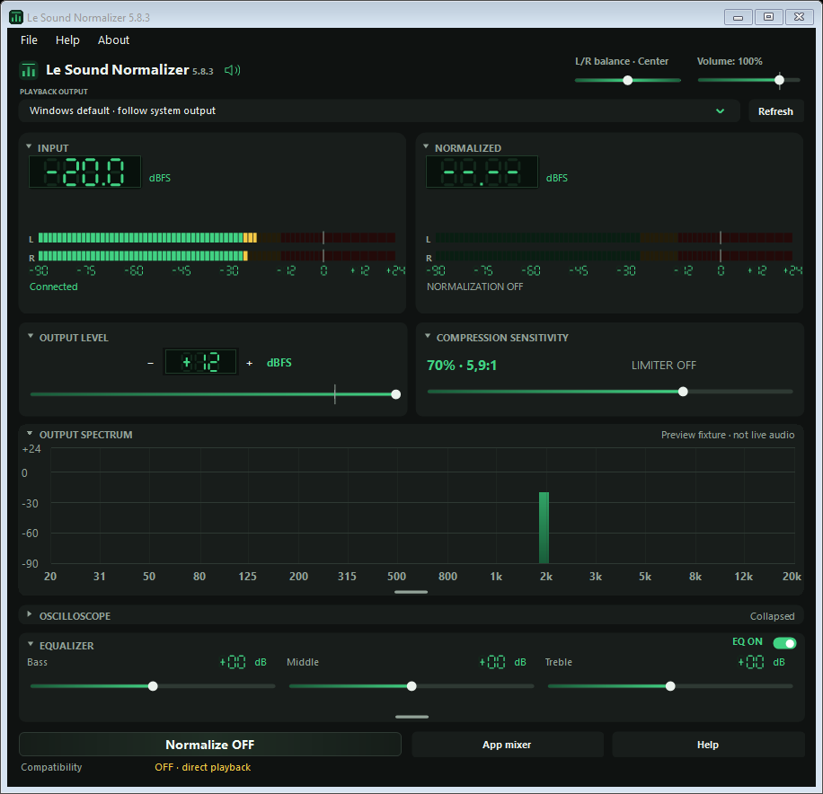
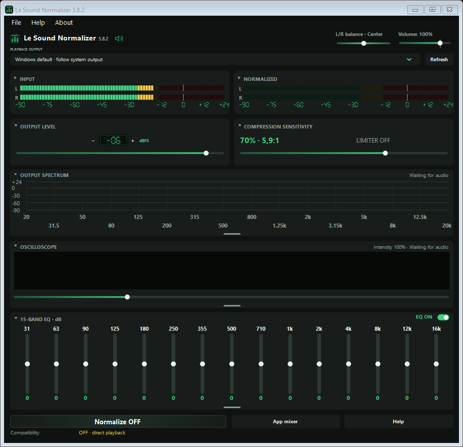

# Le Sound Normalizer

Le Sound Normalizer is a Windows audio tool that keeps loud scenes from overpowering quiet dialogue. Turn the volume up so speech is understandable and the next explosion would normally blast out; the normalizer holds the output under a ceiling you choose and evens out the gap between quiet and loud passages, so a film, a series or a game stays comfortable at one listening level. It runs as a small controller window next to a native audio component that sits in the Windows audio path, so it works with the player you already use. Built and maintained by Logic Encoder at [logicencoder.com](https://logicencoder.com).

## Tech stack

| Layer | Technologies |
|---|---|
| Controller | C#, Windows Forms, .NET Framework 4.8, x64 |
| Audio component | C++ Windows audio processing object (APO) loaded by the Windows shared-mode audio engine |
| Compatibility engine | WASAPI capture and playback with NAudio (MIT licence) and an existing VB-CABLE installation |
| DSP | 32-bit floating-point processing for 1, 2, 6 and 8 channels, sample-peak limiter, compression, tone and graphic equalizer |
| Controller to component link | Shared settings block with revision and sequence ownership, bounded telemetry ring |
| Packaging | Single setup executable with controller, audio component and runtime files |
| Verification | Native processing scenario suite, controller and UI checks, installer checks |

## How loud scenes are tamed

The main window is built around one idea: set a ceiling, then choose how firmly loud material is pulled toward quiet material.

- **Output level** is the digital peak ceiling, from -60 to +12 dBFS in both engines, with a marker at 0. The limiter at the end of the chain keeps samples below it. Positive values describe internal floating-point headroom and can overshoot a later stage, so the useful range for everyday listening is below zero.
- **Compression sensitivity** decides how strongly dynamics are reduced. Three starting points are offered: Soft at 23%, Balanced at 42% and NMS at 66%. A slider adjusts the sensitivity from there, and a readout beside it shows the compression percentage, the ratio and the current gain reduction in decibels.
- **Volume** is everyday listening volume. Above 100% it becomes a small preamp boost (up to 125%, about 1.9 dB) applied before the compressor and limiter, so a quiet signal can be lifted without raising the ceiling. A tick marks exactly 100% where the preamp range begins.
- **Normalize ON/OFF** switches normalization on and off, so the unprocessed sound is one click away for comparison.

The two tuning controls, Output level and Compression sensitivity, sit directly under the LED meters by default and can be placed side by side or swapped left and right in the layout settings.

## Meters, spectrum and waveform

The top of the window is a compact pair of green LED meters with scales and a connection status per output. When an output is muted, the meter keeps showing MUTED and its readings fall to the floor, so silence is never mistaken for a lost connection. Yellow and red warning levels keep their meaning in every colour palette.

Below the meters, three collapsible displays describe what the processor is doing:

- A **frequency spectrum** with integer captions in one row and labels large enough to read at a glance.
- An **oscilloscope-style waveform strip**, a compact filled live waveform in the application's colours. A **Wave intensity** slider above it scales the display from 30% to 3000% without changing audio volume; the percentage is shown and saved, and a double-click or the Home key returns it to 100%.
- The **equalizer** (described below), with its own header switch.

Collapsing a panel leaves free space and keeps the other panels at their sizes. A short, thicker line at the bottom of each expanded panel adjusts its height; heights are remembered separately for the simple and graphic equalizer. When the window is resized, extra height is distributed to the expanded visual panels so the dashboard fills the window.

## Tone and equalizer

Two equalizer views live in Settings under Audio and keep their own values:

- A **simple tone panel** with bass, middle and treble, each plus or minus 18 dB, and left/right balance. Balance snaps to the centre and leaves the centre and LFE channels unchanged.
- A **graphic equalizer** with up to fifteen vertical bands, each plus or minus 18 dB; switching views preserves the original frequency gains. Track thickness is adjustable from 4 to 16 px.

A small **EQ ON/OFF** switch in the equalizer header bypasses equalization only. Normalization and the output ceiling stay active, saved band values are kept, and the switch state is stored in preferences and in sound presets.

## Presets and preferences

Save and load your own sound presets; the EQ switch state travels with them. Preferences remember the window layout, panel order, panel heights, disclosure state, text size and colour palette, so the window opens the way it was left.

## Appearance and layout

- **Colour palette:** Green or Cyan. Controls, displays, spectrum, waveform and the application icons follow the choice, and System, Light or Dark appearance is chosen independently.
- **Layout:** Settings lets you reorder the meter row, tuning row, spectrum, oscilloscope and equalizer, choose which sections start expanded, swap the tuning sides and show optional compression readouts. The dashboard uses the full window width.
- **Text size:** spectrum labels, equalizer labels and supporting text scale independently, with larger frequency labels and gain values as the default and room reserved so nothing overlaps.

## Recording inputs and listening

A dedicated area lists the Windows recording inputs with live level meters. Listening to an input is explicit: choose Enable or Disable for each input, then Save; changes apply on save and the status line shows whether it was saved or applied. The speaker button mutes or unmutes the selected Windows output only when clicked, and the mute and reduced-volume protections of the application are preserved across settings changes.

## Audio engines

- **System DSP (default).** The application's own audio component runs inside the Windows shared-mode audio engine. It needs no Equalizer APO, Peace or virtual cable. Setup asks for administrator approval once; everyday use of the controller does not. The installer records existing endpoint effects and keeps their order ahead of the final limiter, and it never changes Windows audio protection or test-signing policy.
- **Compatibility engine (optional).** A WASAPI capture and playback path that uses an existing VB-CABLE installation, with automatic fallback when its prerequisites are present. The cable is needed only for this route.

The processor handles mono, stereo, 5.1 and 7.1 floating-point PCM without downmixing. A **Restart audio** button in Settings under Audio restarts Windows Audio only after an administrator confirmation, refuses to run while dependent services are active and keeps the mute and reduced-volume restrictions.

## Diagnostics and help

The bottom row combines the engine choice with live audio details, and preamp gain above 100% appears in the status line and in diagnostics. A short Help window explains the purpose and controls, About describes the purpose, and local application, native-component and crash diagnostics are recorded in Logs. Adjusting the equalizer keeps the runtime text steady instead of flashing settings messages; important errors stay visible.

## Playback it covers

The ceiling applies to audio that the player decodes to PCM and that Windows routes through its audio effects chain. Compressed movie audio therefore works once the player decodes it. Encoded HDMI or S/PDIF passthrough, exclusive-mode streams and outputs where Windows bypasses effects follow the player's or the device's own level control. Digital dBFS readings describe the signal inside the processor; real loudness at the speakers also depends on the amplifier and the room.

## Quality checks

Each release runs a native processing scenario suite (417 isolated scenarios for the fifteen-band release), controller and interface checks and a standalone installer check. The exact native module is confirmed as loaded by Windows Audio on the development host, and a silent zero-only playback probe confirms fresh processing telemetry after the audio reload. Detailed versioned verification is kept with the source.

---

Private code: [le-sound-normalizer](https://github.com/logicencoder/le-sound-normalizer)

Logic Encoder · [GitHub](https://github.com/logicencoder) · [Contact](https://logicencoder.com/contact/)
